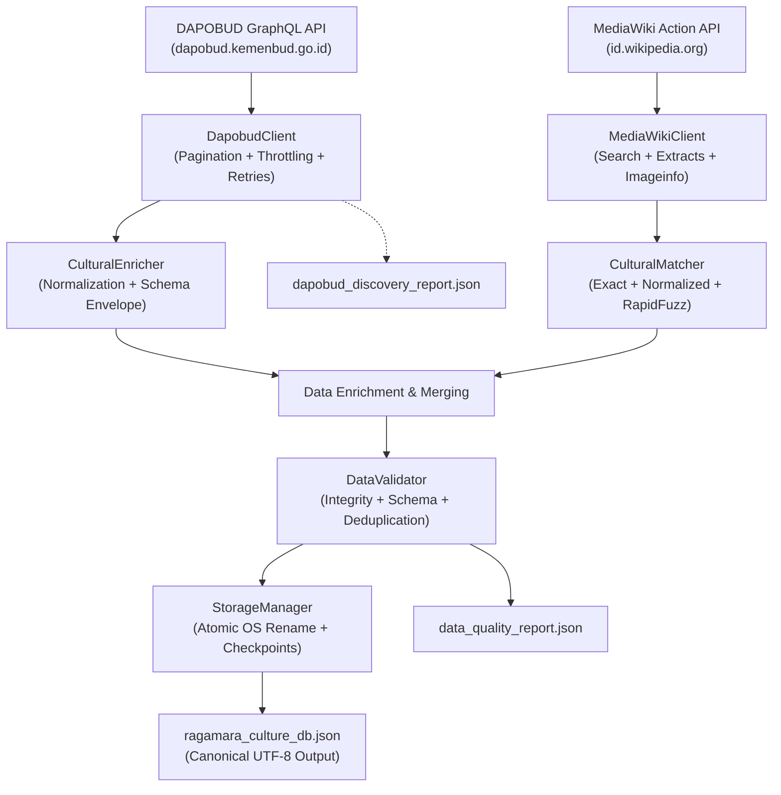

# RAGAMARA Cultural Data Enrichment Engine
### Official Indonesian Cultural Registry (DAPOBUD) × Wikipedia Indonesia Knowledge Graph

[](https://python.org)
[](LICENSE)
[]()

The **RAGAMARA Cultural Data Enrichment Engine** is an automated data engineering pipeline designed to ingest, normalize, enrich, validate, and store authentic Indonesian cultural heritage records for the **RAGAMARA** interactive learning and gaming platform (BUDAYA GO! 2026).

---

## 1. System Architecture

The pipeline orchestrates official cultural records from the Ministry of Culture Republic of Indonesia (**DAPOBUD**) with supplementary encyclopedic context and licensed visual media from **Wikipedia Indonesia** via the MediaWiki Action API.



---

## 2. Core Modules

| Module | Location | Primary Responsibilities |
|---|---|---|
| `settings.py` | `config/settings.py` | Centralized endpoints, rate limits, backoff factors, and path configuration. |
| `dapobud_discovery.py` | `src/dapobud_discovery.py` | Probes live servers, checks robots.txt, discovers GraphQL operations, outputs discovery report. |
| `dapobud_client.py` | `src/dapobud_client.py` | Executes `ReadAllWBTB`, `FindOneWbtb`, and `FindAllDapobud` queries with retry and fallback parsing. |
| `mediawiki_client.py` | `src/mediawiki_client.py` | Queries Wikipedia search, fetches intro extracts, resolves image thumbnails and creative commons licenses. |
| `normalization.py` | `src/normalization.py` | Unicode NFKC normalization, administrative prefix stripping, province & regency standardization. |
| `matching.py` | `src/matching.py` | Confidence scoring, disambiguation filter, token-sort ratio with contextual province boost. |
| `enrichment.py` | `src/enrichment.py` | Merges official DAPOBUD metadata with supplementary encyclopedia details and creative commons licenses. |
| `data_validator.py` | `src/data_validator.py` | Rigorous schema audit, malformed URL checks, duplicate detection, and automated quality metrics. |
| `storage.py` | `src/storage.py` | Deterministic record IDs (`id_dapobud_*` / `id_hash_*`), crash-resilient atomic file writing, checkpoint recovery. |
| `pipeline.py` | `src/pipeline.py` | High-level orchestrator connecting all stages. |
| `main.py` | `main.py` | CLI interface supporting `--discover`, `--limit`, `--resume`, `--stats`, and `--dry-run`. |

---

## 3. Installation & Quick Start

### Prerequisites
- Python 3.10+
- Internet connectivity to `dapobud.kemenbud.go.id` and `id.wikipedia.org`

### Installation
```bash
# Clone or navigate to the data engine
cd ragamara-data-engine

# Create virtual environment
python3 -m venv venv
source venv/bin/activate

# Install dependencies
pip install -r requirements.txt
```

---

## 4. Command Line Usage

### Initial Discovery
Probe DAPOBUD server infrastructure and verify GraphQL capabilities:
```bash
python main.py --discover
```

### Pilot Run (10 Records)
Extract and enrich 10 records across WBTb and OPK:
```bash
python main.py --limit 10
```

### Full Run
Execute full ingestion across all registered entities:
```bash
python main.py
```

### Resuming Interrupted Run
Resume execution safely using the cached checkpoint:
```bash
python main.py --resume
```

### Display Database Statistics
Display high-level counts, enrichment rates, and image license tallies:
```bash
python main.py --stats
```

### Running Automated Test Suite
```bash
pytest tests -v
```

---

## 5. Output Schema Specification (`ragamara_culture_db.json`)

The final database adheres strictly to the canonical schema defined in Section 9:

```json
{
  "metadata": {
    "database_name": "RAGAMARA Cultural Knowledge Database",
    "schema_version": "1.0.0",
    "generated_at": "2026-11-13T18:48:54.665638+00:00",
    "language": "id",
    "primary_source": "DAPOBUD",
    "enrichment_source": "Wikipedia Indonesia",
    "total_records": 10,
    "successful_enrichments": 5,
    "unmatched_records": 5,
    "records_requiring_review": 1
  },
  "sources": {
    "dapobud": {
      "name": "Data Pokok Kebudayaan",
      "base_url": "https://dapobud.kemenbud.go.id/",
      "graphql_url": "https://dapobud.kemenbud.go.id/backend/graphql",
      "role": "official_cultural_registry"
    },
    "wikipedia": {
      "name": "Wikipedia Indonesia",
      "api_url": "https://id.wikipedia.org/w/api.php",
      "role": "supplementary_encyclopedic_enrichment"
    }
  },
  "records": [
    {
      "record_id": "id_dapobud_f31f397c-0647-4667-bbfb-6aa1397ca224",
      "name": "Rencong",
      "normalized_name": "Rencong",
      "dapobud": {
        "official_id": "f31f397c-0647-4667-bbfb-6aa1397ca224",
        "number": "REK/WBTB/2013/01/00001",
        "entity_type": "WBTB",
        "category": "Ketrampilan dan Kemahiran Kerajinan Tradisional",
        "region": {
          "province": "Aceh",
          "regency_city": null
        },
        "official_description": "Menurut catatan sejarah, Rencong merupakan senjata tradisional...",
        "assignment_date": "2013-01-01 00:00:00",
        "source_url": "https://dapobud.kemenbud.go.id/wbtb/detail-wbtb/?id=f31f397c-0647-4667-bbfb-6aa1397ca224"
      },
      "wikipedia": {
        "status": "matched",
        "language": "id",
        "page_id": 39321,
        "page_title": "Rencong",
        "page_url": "https://id.wikipedia.org/wiki/Rencong",
        "extract": "Rencong adalah senjata khas Suku Aceh...",
        "image": {
          "thumbnail_url": "https://upload.wikimedia.org/...",
          "creator": "Tropenmuseum",
          "license": "CC BY-SA 3.0",
          "license_url": "https://creativecommons.org/licenses/by-sa/3.0",
          "attribution": "Creative Commons Attribution-Share Alike 3.0"
        },
        "match": {
          "confidence": 1.0,
          "method": "exact",
          "review_status": "not_required"
        }
      },
      "provenance": {
        "official_source": "DAPOBUD",
        "supplementary_source": "Wikipedia Indonesia",
        "last_enriched_at": "2026-11-13T18:48:34.000000+00:00"
      },
      "quality": {
        "record_valid": true,
        "has_official_region": true,
        "has_wikipedia_enrichment": true,
        "requires_manual_review": false,
        "validation_issues": []
      }
    }
  ]
}
```

---

## 6. Cultural Integrity & Ethical Scraping Guarantees

1. **No Hallucinated Data**: Unmatched records retain `wikipedia.status = "no_match"` with null subfields. Official DAPOBUD data is never modified or fabricated.
2. **Attribution & Licensing**: Every media asset extracted carries direct license metadata, artist attribution, and Commons source URLs.
3. **Respectful Throttling**: 1.0s polite delay between requests, adherence to `Retry-After` on HTTP 429, and bounded exponential backoff.
4. **Resumable & Atomic**: Interrupted operations save checkpoints every 10 items; output files are updated atomically via temp file renaming to prevent partial corruption.
