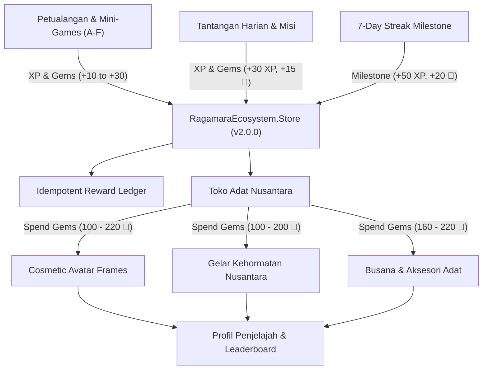

# NULAR (Nusa Learn) — Gamification & Virtual Economy System Report

**Date:** 2026-11-15  
**Product:** NULAR — The Living Atlas of Nusantara  
**Branch:** `feat/ragamara-final-experience`  
**Status:** IMPLEMENTED & VERIFIED  

---

## 1. Executive Summary

As part of the NULAR Master UI/UX & Gamification Transformation, the platform's gamification systems were upgraded from passive XP counters into an active, rewarding cultural adventure loop. Players can now earn cultural gems and XP through interactive mini-games, maintain daily learning momentum with a 7-day visual streak tracker, customize their explorer identity with authentic cultural titles and avatar frames, and spend earned currency in the **Toko Adat Nusantara** cosmetic shop.

---

## 2. Core Gamification Architecture

---

## 3. Virtual Economy & Anti-Exploit Security

1. **Balance Non-Negativity:** The `TokoAdat.purchase(itemId)` controller asserts `player.gems >= item.price`. Transactions below the price boundary are rejected immediately.
2. **Idempotent Transaction Ledger:** Every awarded reward and cosmetic acquisition is stamped into `Store.state.claimedRewardLedger` (e.g. `shop_purchased_frame_majapahit`, `streak_milestone_7days`, `session_uuid`). Duplicate requests are ignored, preventing double-spend exploits.
3. **Transparent Sourcing:** Gems are exclusively earned through educational activities (mini-game completion, perfect scores, daily missions, and streak milestones). No dark patterns or real-money monetization exist.

---

## 4. Toko Adat Nusantara Catalog

| Category | Item Name | Cultural Origin | Price | Description |
| :--- | :--- | :--- | :---: | :--- |
| **Bingkai** | Bingkai Emas Minangkabau | Sumatra Barat | Gratis | Ukiran emas khas Luhak Nan Tigo nan megah dan berwibawa. |
| **Bingkai** | Bingkai Terakota Majapahit | Jawa Timur | 120 💎 | Bata merah terakota bercorak Surya Majapahit nan abadi. |
| **Bingkai** | Bingkai Zamrud Asmat Papua | Papua | 150 💎 | Ukiran kayu bakau dan spiral pusaka rimba pesisir Papua. |
| **Bingkai** | Bingkai Tenun Kanekes Baduy | Banten | 180 💎 | Tenunan kapas alami cermin kesederhanaan Urang Kanekes. |
| **Gelar** | Ahli Warisan Minang | Minangkabau | Gratis | Memahami filosofi luhur Alam Takambang Jadi Guru. |
| **Gelar** | Penjaga Adat Nusantara | Nasional | 100 💎 | Penjaga kemurnian adat istiadat dari Sabang hingga Merauke. |
| **Gelar** | Kurator Pusaka Bahari | Jalur Rempah | 140 💎 | Menjelajahi jalur rempah dan keagungan maritim Nusantara. |
| **Gelar** | Cendekiawan Budaya Luhur | Paripurna | 200 💎 | Gelar kehormatan tertinggi penuntas seluruh ekspedisi. |
| **Busana** | Deta Saluak Minangkabau | Minangkabau | Gratis | Penutup kepala adat lambang kebijaksanaan penghulu. |
| **Busana** | Selempang Batik Parang Barong | Jawa Tengah / DIY | 160 💎 | Motif lereng keraton lambang kesatria pantang menyerah. |
| **Busana** | Hiasan Mahkota Kasuari Papua | Papua | 220 💎 | Anyaman bulu alami simbol ketangkasan dan kehormatan. |

---

## 5. 7-Day Streak Journey System

- **Visual Tracking:** Displays a 7-day Mon–Sun timeline with checkmark status on completed days and active fire indicator on the current day.
- **Weekly Milestone Reward:** Users reaching the 7-day milestone can claim an exclusive chest granting **+50 XP** and **+20 Gems**.
- **Anti-Exploit Protection:** The claim method checks `claimedRewardLedger` ensuring the weekly milestone can only be claimed once per cycle.

---

## 6. Procedural Web Audio Engine (`RagamaraAudio`)

A pure Web Audio API synthesizer produces authentic, zero-dependency sound feedback:
- **`playGamelanChime()`:** Random pentatonic slendro notes (261.63 Hz – 523.25 Hz) with warm sine waves and exponential decay.
- **`playSuccessFanfare()`:** Ascending C-Major victory chord (C5, E5, G5, C6) for mission completions and profile saves.
- **`playPurchaseChime()`:** Sparkling coin chime (E5, G#5, B5, E6) celebrating shop purchases.
- **`playTap()`:** Soft 440 Hz tactile tick for UI interactions.
- **Accessibility & Settings:** All sound synthesis respects `Store.state.settings.sfxEnabled` and can be toggled in one click.

---

## 7. Verification Summary

- Automated E2E verification executed via headless Chrome (`tests/test_nular_gamification.mjs`).
- Store initialization, purchase transaction ledger, streak milestone claim idempotency, and profile editor modal all passed with zero errors.
